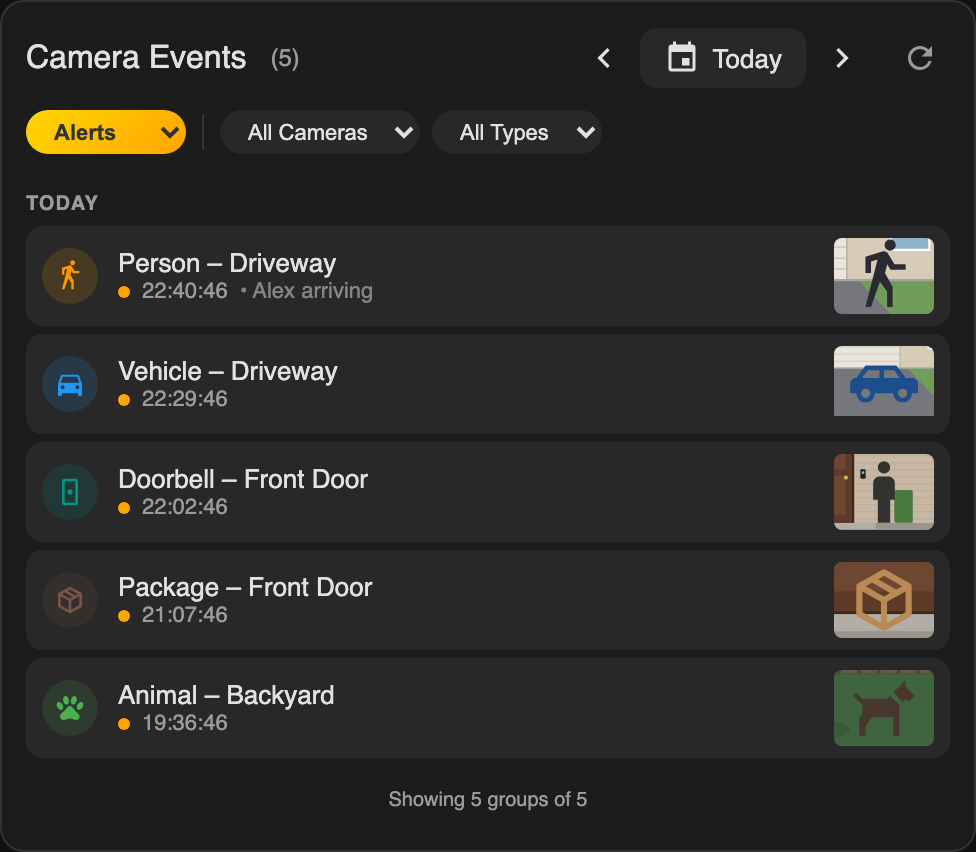
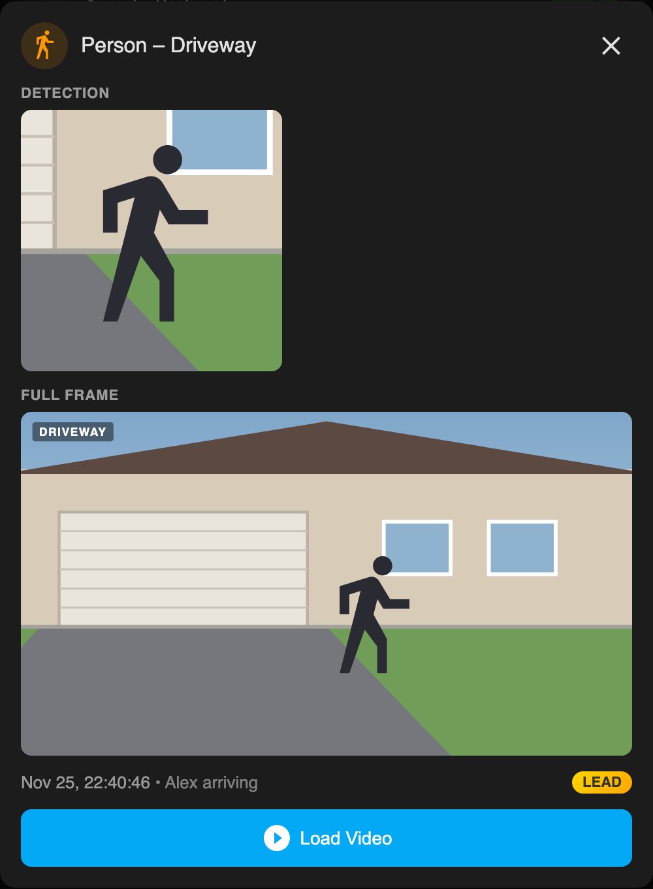
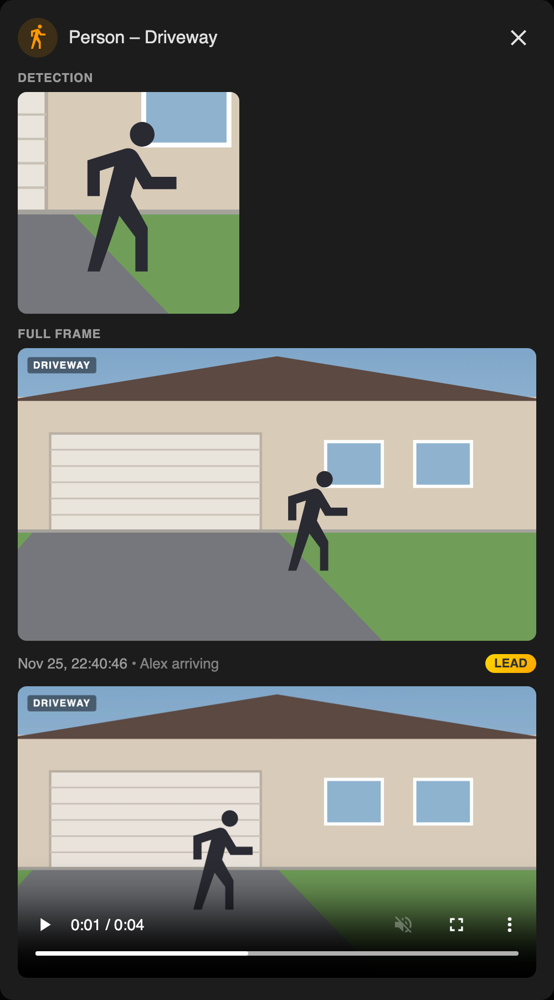

# UniFi Protect Events Card

A Home Assistant dashboard card that shows your **UniFi Protect** detections as a timeline: person, vehicle, animal, package and doorbell events, each with its thumbnail. Tap an event for a larger image, a full-frame snapshot and the video clip.

- Timeline grouped by Today, Yesterday and older dates
- Filters by camera, detection type and date range (your choices are remembered on each device)
- Popup with the detection crop, a full-frame snapshot and inline video playback
- Optional arrival/departure context ("Alex arriving") from your `person` entities
- Refreshes every few minutes, and holds off while you're scrolling

| Timeline | Tap an event | Load the clip |
|:---:|:---:|:---:|
|  |  |  |

<sub>Screenshots use illustrated sample images. With your cameras you'll see real snapshots.</sub>

The card's type is `custom:camera-events-card`, as shown in the examples below.

## Requirements

- Home Assistant with the **UniFi Protect** integration. The card reads thumbnails and video from it, so other camera systems won't work.
- Cameras with **smart detections** turned on in UniFi Protect. Each one gets an `event.<camera>_smart_detection` entity in HA; if you don't see those, the blueprint has nothing to log.
- A **calendar** to hold the events, created with the built-in **Local Calendar** integration.
- An automation that writes detections to that calendar. The included blueprint does this for you.

## Install

### 1. Add the card

**With HACS (recommended)**

1. HACS → ⋮ (top right) → **Custom repositories**
2. Repository: `https://github.com/ziptbm/unifi-protect-events-card`, Type: **Dashboard**, then **Add**
3. Search HACS for **UniFi Protect Events Card**, then **Download**
4. Reload your browser when it asks

**Manual**

1. Download `camera-events-card.js` from this repo into `/config/www/`
2. Settings → Dashboards → ⋮ → **Resources** → **Add resource**
   - URL: `/local/camera-events-card.js`
   - Type: **JavaScript module**

### 2. Create the calendar

Detections are stored as events in a calendar, which the card then reads.

[](https://my.home-assistant.io/redirect/config_flow_start/?domain=local_calendar)

1. Use the button above, or go to Settings → Devices & services → **Add integration** and search for **Local Calendar**
2. Calendar name: `Camera Events` (exactly that)
3. Check it worked: Settings → Devices & services → **Entities**, search `calendar.camera_events`

Used a different name? Find its entity ID in step 3, pick that calendar in the blueprint, and set `calendar_entity` on the card.

**Good to know**
- Every detection becomes a 1-minute event, so this calendar fills up fast. In the **Calendar** sidebar, untick it so it doesn't crowd your real calendars. The card isn't affected.
- Old events stay in the calendar. That's fine: the card only loads the dates you're viewing.

### 3. Start logging detections

[](https://my.home-assistant.io/redirect/blueprint_import/?blueprint_url=https%3A%2F%2Fgithub.com%2Fziptbm%2Funifi-protect-events-card%2Fblob%2Fmain%2Fblueprints%2Fautomation%2Fcamera-events-card%2Flog-unifi-protect-detections.yaml)

Import the blueprint with the button above (or Settings → Automations & scenes → Blueprints → **Import blueprint**, then paste the blueprint's URL). Then create an automation from it:

- **Detection event entities:** each camera's **Smart detection** entity (for example `event.driveway_smart_detection`), plus the **Doorbell** entity if you have a UniFi doorbell
- **Calendar:** `calendar.camera_events`
- **Detection types:** person, vehicle and doorbell are selected by default

Walk past a camera, and the event should show up in the calendar within a few seconds.

#### Optional: phone alerts, grouping and arrivals

The blueprint has three optional sections. Each one is off until you fill it in.

| Section | What it does | How to turn it on |
|---|---|---|
| **Phone alerts** | Sends a notification for each alert, with the camera name as the title and the detection thumbnail as the image. Tapping it opens the dashboard path you give. | Pick one or more phones running the Home Assistant Companion app. |
| ↳ Cooldown | After a camera alerts, it sends no more phone alerts for this many minutes. Its detections are still logged. | Set minutes above 0. |
| **Grouping** | A detection within N minutes of the last alert is logged under that alert, not as a new one, and sends no notification. Someone walking past three cameras gives you one alert. | Set the quiet period above 0 (3 is a good start). |
| **Household arrival** | When one of the chosen people has come home in the last few minutes, detections are logged but not as alerts, and send no notification. They don't appear in the **Alerts** view; when two or more fall in the window, the **Groups** view labels them **Arrival**. | Pick the people. |

Doorbell rings are always an alert. They are never grouped or quietened, and ignore the cooldown. A ring can still be the alert that later detections group under.

Household arrival works best when presence updates quickly, for example with a home zone a little larger than your house. If the camera sees someone before their phone reports them home, that detection is still an alert. After Home Assistant restarts, everyone at home counts as just arrived, so detections stay quiet for the arrival window.

Devices that can't receive notifications, such as a watch, are skipped. To check a phone, look for `notify.mobile_app_<phone name>` under **Developer tools → Actions**.

The blueprint needs no extra helpers: it checks the calendar for earlier alerts.

Example: alerts on two phones, with grouping and arrivals:

- **Phones to alert:** Alex's phone, Sam's phone
- **Open when tapped:** `/dashboard-cameras/0`
- **Cooldown per camera:** 5
- **Quiet period:** 3
- **People:** `person.alex`, `person.sam`
- **Arrival window:** 5 (the default)

Alex walks up the driveway, past the front door, and is seen by three cameras in a minute. You get one notification from the first camera. In the card's **Groups** view, the other two detections sit under it. When Sam drives home, the detections in the next 5 minutes are logged as an **Arrival** group with no notification.

### 4. Add the card to a dashboard

Edit dashboard → **Add card** → search **UniFi Protect Events Card**. To change options, use **Show code editor** in the card dialog, or paste this:

```yaml
type: custom:camera-events-card
calendar_entity: calendar.camera_events
```

The card works best on its own view, or in a tall section.

## Options

| Option | Default | What it does |
|---|---|---|
| `calendar_entity` | `calendar.camera_events` | Calendar the events are read from |
| `max_events` | `200` | The most groups the card will load. It shows 50 at a time, with **Load more** for the rest. |
| `default_view_mode` | `alerts` | Starting view: `alerts`, `groups` or `all`. Only used until you pick one on the card. |
| `camera_entities` | auto | Maps a camera name to its camera entity, for the full-frame snapshot. Usually not needed: the card finds `<Camera> High resolution channel` by itself. |
| `person_entities` | every `person.*` | People to check for arrivals and departures. Give a list to limit it, or `false` to turn it off. |

A fuller example:

```yaml
type: custom:camera-events-card
calendar_entity: calendar.camera_events
max_events: 100
default_view_mode: all
camera_entities:
  Driveway: camera.driveway_high_resolution_channel
person_entities:
  - person.alex
  - person.sam
```

## Calendar event format

The blueprint writes events in the format below. If you write your own automation instead, follow it:

```yaml
summary: Person            # Person, Vehicle, Animal, Package or Doorbell
location: /api/unifiprotect/thumbnail/<nvr_id>/<event_id>,<Camera name>
description: |-
  Status: LEAD
  Camera: Driveway
  Detection: person
  Time: 14:30:45
```

The blueprint also writes `Source:` (the event entity) and, when it sent a phone alert, `Notified: yes`. The card ignores lines it doesn't know.

- `nvr_id` is `config_entry_id(<any UniFi Protect entity>)`
- `event_id` is the `event_id` attribute of the camera's Smart detection (or Doorbell) event entity
- The camera name must not contain a comma

### Advanced: grouping and suppression

The card groups related events: someone walks past three cameras, and you see one alert instead of three. The blueprint's **Grouping** and **Household arrival** sections do this for you. If you write your own automation instead, mark the alert `Status: LEAD` and the rest `Status: SUPPRESSED`, adding these lines:

```
LeadTime: <start time of the LEAD event, ISO format>
SuppressReasons: path_grouping,person_arrival   # or none
```

Reasons the card turns into a group label: `outdoor_activity`, `person_arrival`, `person_departure` and `vehicle_active`. Any other reason is allowed but gets no label.

Suppressed events with the same `LeadTime` appear under their LEAD event in the **Groups** view. The **Alerts** view shows LEAD events only, and **All** lists every event on its own. The blueprint writes these lines for you when grouping or household arrival is on.

## Troubleshooting

- **Nothing shows up.** Check that the calendar has events in it (open it in the Calendar panel). If it's empty, check the automation's trace.
- **The thumbnail is missing.** UniFi Protect sometimes takes a few seconds to produce a thumbnail. Tap **Retry** in the popup.
- **The video won't load.** The clip only exists once the detection has ended. Try again a minute later.
- **"Full frame unavailable."** Add the camera to `camera_entities`, using the exact name the card shows.

## Development

```bash
node --test tests/
```

## License

MIT
